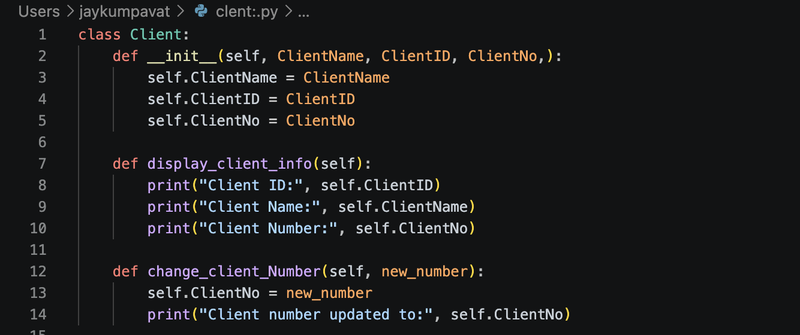
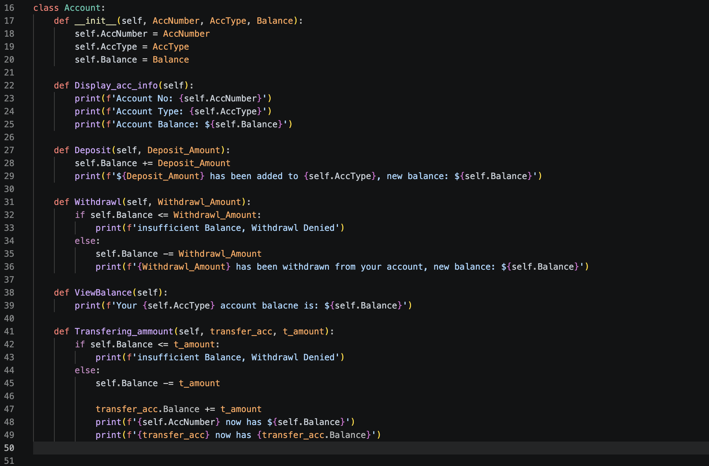
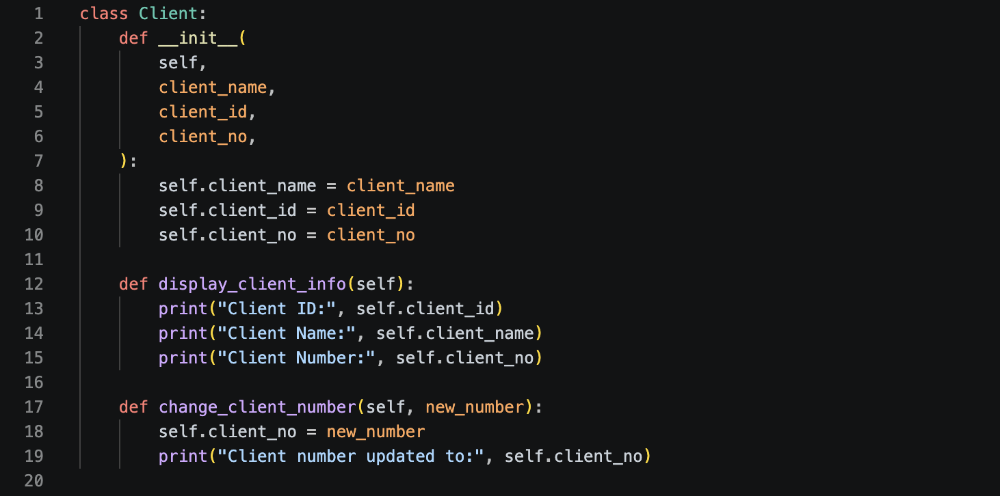
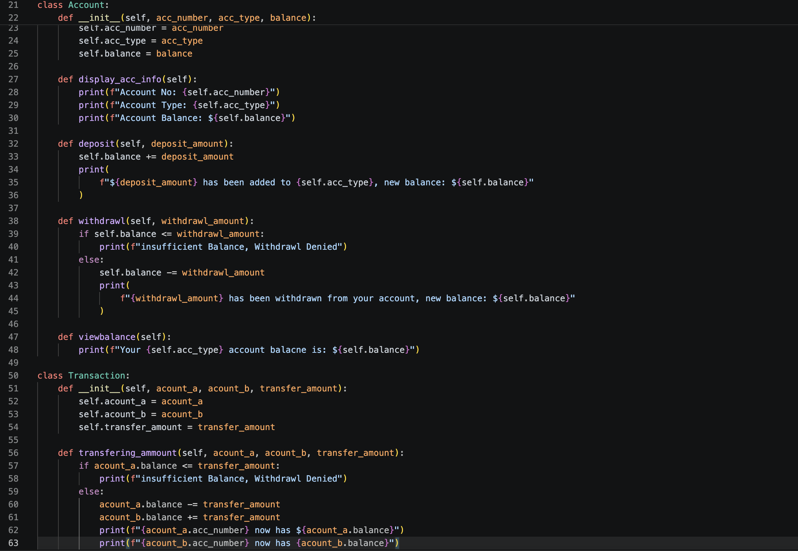
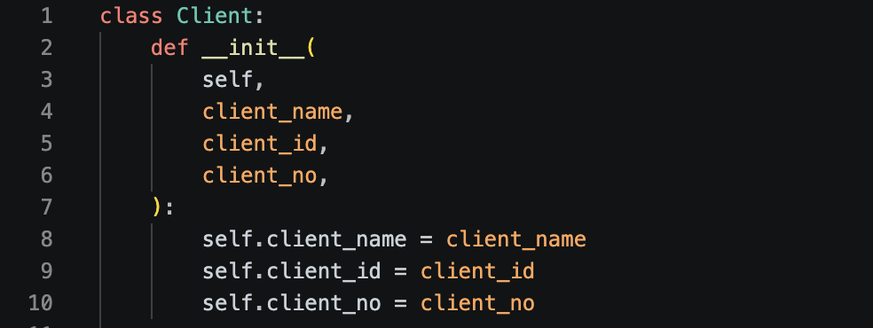
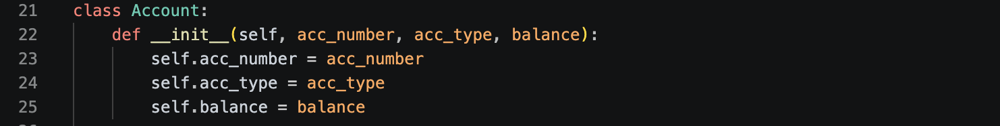
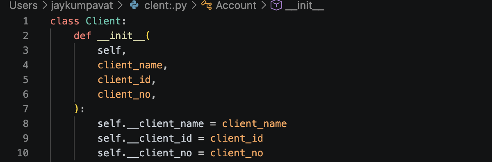
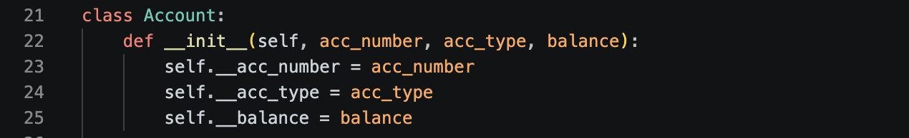
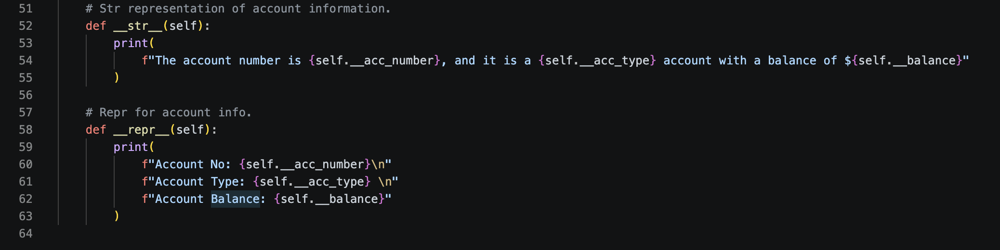
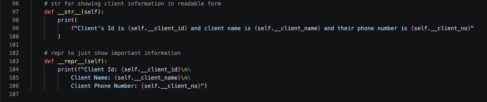

# Code Reviews

git repo:
https://github.com/JayKumpavat/OOP.git

## **Week 2**
Feedback:
- make separate class for transferring money from different amounts
- Use pep8 formatting

learning experience:
during the discussion/ code review, my tutor explained why account should only have one responsbility, refering to SOLID's principles. He then talked about how its easier to test the account logic and transaction logic seperatly. He also commented to apply pep8 formatting which I hadn't gotten up to but was prepering to start. I asked him why we should use it and he responded by saying that if your working in a company or with a team, having the same formatting can make reading and editing code easier as everyone is writing very similarly. 

**Evidence of Code Change**

*Before*

**transfer in same as account and no pep8 formatting**





*After*

**pep8 formatting and moved transfer**





**Justification**
For the following changes, I implemented pep8 formatting through the use of the extention for python that does it for you. This improved the readability of my code. I have also moved the transfer funciton to its own class. This follows SOLIDS principles and I can now see how it has made it easier for me to review the code and also makes testing easier now that it is isolated and not apart of another system.

****
## **Week 3**
Feedback:
- explained how str and repr are different and why they are used
- explained how private attributes work and were to implement them in my code 

learning experience:
I was confused at first between str and repr since they both seemed to output the same values, where one is just in sentence form and the other not. The tutor basically explained that str is meant to give a description of an object, in a way the user can read and repr is meant to give a more technical description, generally aimed at a developer. Now with private attributes, he told me to apply them to the attributes that don't want to be changed outside the function or read from outside the function. 

**Evidence of Code Changes**

*Before*
**No Private Class**





*After*

**Updating to private class**





**Adding Repr and Str**






*note the following images provided in the code review files, I have only taken for account and client. The rest of the changes applied to all othe r classes can be found in the git commit section.

**Justification**
I have added str and repr to all the classes. This really helped me out during the testing phase as after each change I made from the main.py file, I could call repr to show what the current states of the values were and if they matched with the correct output. This also helped me debug. Also by privating most of the attributes, my code is now more safe/ it cannot be view from outside the class or modified out it. 


## **Week 5**

**What Got Reviews**
Account's str method and the getter methods in BankingSystem accounts.py

**My Question**
My str method prints the account details, but when i run print(acc1) it crashes with "TypeError:__str__ returned non-string".

**Feedback**
make sure to only use return for str method, this will resolve the issue


**Code Change Before**
def get_acc_number(self):
    return self.__acc_number

``` python
def get_acc_number(self):
    return self.__acc_number
 
def __str__(self):
    print(
        f"The account number is {self.__acc_number}, and it is a "
        f"{self.__acc_type} account with a balance of ${self.__balance}"
    )
```
After (Workshop 4-2)

```python
@property
def acc_number(self) -> int:
    return self.__acc_number
 
def __str__(self) -> str:
    return (
        f"{self.__acc_type} account {self.__acc_number} "
        f"with a balance of ${self.__balance:.2f}"
    )
```
**Related commits:**
**Related commits:**
- [`a367102`](https://github.com/JayKumpavat/OOP/commit/a367102) Moved withdraw and deposit out of Account into Transactions
- [`9215b40`](https://github.com/JayKumpavat/OOP/commit/9215b40) Moved deposit, withdraw and view balance to a new module
- [`e35d1cd`](https://github.com/JayKumpavat/OOP/commit/e35d1cd) Applied autopep8 to all modules
- [`0240784`](https://github.com/JayKumpavat/OOP/commit/0240784) PEP8 formatting applied to Accounts

Every str and repr in Project 1 now returns a string instead of printing. I swapped my getters for read-only properties, so now it's just account.acc_number. I also got rid of set_balance completely, so the only way a balance can change is through deposit and withdraw.
 
**Concept:** Special methods come with rules, and str has to return a string. Properties are Python's way of letting outside code read private attributes while the class still controls access (encapsulation).
 
**What I learned:** It turns out printing inside str only seemed to work because I was calling the method directly. When Python called it through print, it got None back and threw an error. Properties are a nice middle ground, since the class decides what can be read or changed but the code using it still looks normal.

## **Week 6: Workshop 5-2 (Topic 5)**

**What got reviewd**
SummoningRitual's create_summon method, after I added the undead subclass

**My Question**
Now that every summon has its own class, should the ritual still store the summons name and starting stats or should that live in the subclass?

**Feedback and discussion** 
Data should live with the class that it describes therefore storing the class lets the ritual create the right type. In this case the necromancer doesn't need to change. 

**Code change**
 
Before (Workshop 4-2)
 
```python
def create_summon(self, unit_id: int) -> Undead:
    return Undead(
        unit_id, self.__summon_name, self.__starting_health,
        self.__starting_power
    )
 
SummoningRitual("Rite of Bones", "Undead Skeleton Warrior", 40, 12,
                bone_cost=4, ectoplasm_cost=1)
```
 
After (Workshop 5-2)
 
```python
def create_summon(self, unit_id: int) -> Undead:
    return self.__summon_class(unit_id)
 
SummoningRitual("Rite of Bones", SkeletonWarrior,
                bone_cost=4, ectoplasm_cost=1)
```

The ritual now just stores which class it creates. The name, starting starts and the stat limits all moved into each subclass as constants.

**Concept**
Interitance and responsibility, where a subclass only holds what makes it different. Polymorphism too, since the Necromance just gets an undead back and never has to check the type it has.

**What I learned**
I didn't realise that you could pass a class around and store it like any other value. Moving the stats into the subclasses meant that the level_up could stay in undead and still be used in each subclass's own limits through self which ws very cool.

## ** Week 7: Workshop 6-2 (Checkpoint feedback) **

**What got reviewed:** My new Transfer class compared to my older transfer method i was using

**My Question:**
Is it better for Transfer to change both balances itself, like for instance my old trnsfer method did, or should it call the withdrawl and deposit function on each account

**Feedback and discussion:**
The feedback recieved told me to keep it to a single responsibility. Only account should change its own balance and using the accounts own methods means rules like the savings minimum still apply

**Code Change**

before (Week 3)
```python
# Transaction.transfering() in Week 3
if account_a.balance < t_amount:
    return f"Insuffient Balance, Try Again"
else:
    account_a.balance -= t_amount
    account_b.balance += t_amount
```

After (Workshop 6-2)
 
```python
# Transfer.execute() in Workshop 6-1
withdrawn = self.__source.withdraw(
    self.__amount, f"Transfer to {self.__destination.acc_number}"
)
if not withdrawn:
    self.__status = "Failed"
    return False
 
self.__destination.deposit(
    self.__amount, f"Transfer from {self.__source.acc_number}"
)
self.__status = "Completed"
return True
```

Transfers now have their own class, and it never accesses a balance directly. This is because now it has to go through withdraw, a transfer out of a saving accounts means it automatically adhere's to the $100 minimum, and both accounts get transfer added to their history.

**Concept:**
SOLID Principle, Single Responsibility, encapsulation and polymorphism. Withdraw works differently for each account type and Transfer doesn't need to know which type its dealing with.

**What I learned:**
Before this there were three different places in my code that could change the balance. If I added a rule to Account, it could easily be overlooked. Getting the account to do the work itself keeps the verification/ rules in one place. 

## **Week 8: Workshop 7 (Finalising Project 2)**

**What got reviewed**
My original necromancy game

**My question**
My old necromancer file never seemed to actually set anything up, also it has a lot of dead code, should i just remove it or keep it?

**Feedback and discussion**
First of all, the __int__ contructore was misspelled during the worksop so it could not run. Remove the duplicate lines of code that are not of use.

**Code Change**

Before (progress check)
 
```python
class Necromancer:
    def __int__(self, name, resource_pouch, ):
```
 
After (Workshop 7)
 
```python
class Necromancer:
    def __init__(self, name: str, necrotic_runes: int = 0, ...) -> None:
        self.__name = name
        self.__resources = ResourcePool(...)
        self.__undead = []
        self.__next_unit_id = self.FIRST_UNIT_ID

```
I deleted the unfinished file with the typo, so the complete Necromancer in necromancy_game/necromancer.py is the only one left. I also renamed the package folder to necromancy_game to follow PEP8 and ran the whole project through autopep8 and pycodestyle.

**Concept**
Constructors, cleaning out dead code

**What I learned**
The spelling error made me realise that python doesn't give you an error. It instead makes the normal method with that name. The only way I found out was by running the demo and the object values never got set.

## **Week 9: Workshop 8-2 (Topic 8)**

**what got reviewed**
How client stores its accounts

**Questions I asked**
My client keeps its accounts in a list. Since every accoutn already has a unique number, would a dictionary make more sense?

**Feedback and discussion**
Use a dictionary when you look things up by a unique key and a list whenever order or duplicates matter.

**Code Change**

```python
self.__accounts = []
 
def add_account(self, account: Account) -> bool:
    ...
    if account in self.__accounts:
        print("This account has already been added to this client")
        return False
    self.__accounts.append(account)
    return True
 
def remove_account(self, account: Account) -> bool:
    if account not in self.__accounts:
        print("This account is not assigned to this client")
        return False
    self.__accounts.remove(account)
    return True
```
 
After (Workshop 8-2)
 
```python
self.__accounts = {}
 
def add_account(self, account: Account) -> bool:
    ...
    if account.acc_number in self.__accounts:
        print(f"Account {account.acc_number} is already held by "
              f"this client")
        return False
    self.__accounts[account.acc_number] = account
    return True
 
def get_account(self, acc_number: int) -> Account:
    return self.__accounts.get(acc_number)
 
def remove_account(self, acc_number: int) -> bool:
    if self.__accounts.pop(acc_number, None) is None:
        print(f"Account {acc_number} is not held by this client")
        return False
    return True
```

Accounts are now stored in a dictionary using the account number as the key. This way, I am able to look up an account straight away with get_account or has_account, and remove_account just neds the number now instead of the whole object. 

**Concept**
Picking a data structure based on how you actually use the data: a dictionary for looking things up by key, a list for history where order matters. Also keeping a collection private by only returning a copy.

**What I learned**
With the list, finding account 1002 meant going through every account one by one, removing one meant I needed the actual object but now the dictionary lines up with how real bank works so i now only need thier number.

## **Week 10: Workshop 9-1 Topic 9**

**What got reviewed**
The getters in gym_tracker/workout.py while i was planning my tests

**My Questions**
The workshop sheet says not to test getters and setters. Should I still keep getters like Workout.title and Workout.date if nothing actually uses them?

**Feedback and discussion**
delete once written the test behaviours. You can check the behaviour thorugh other uses such as str or describe method

**Code change**
 
Before (Workshop 8-1)
 
```python
@property
def title(self) -> str:
    return self.__title
 
@property
def date(self) -> str:
    return self.__date
```
 
After (Workshop 9-1)
 
```python
# Removed. The private attributes stay because __str__ uses them,
# and the test checks the behaviour instead:
def test_str_lists_exercises_and_total(self, full_workout):
    text = str(full_workout)
    assert text.startswith("Push Day on 2026-10-20 (in progress)")
```

I went through the project 3 and removed every getter that nothing was reading such as workout's title and date, exercise sets and member goal, trainer speciality and gym name. I kept the Member.workouts and trainer.client_count because ther demo tests and uses them.

**Concept**
Unit testing is about behavior, not about getters. Getting rid of unused code

**What I learned**
I have been adding a getter for every private attribute "just in case", but writing the tests showed me which ones actually mattered. Because the tests check the real results like describe and calcualte and not just the raw values.

## **Week 11: Workshop 10-1 (Topic 10)**

**What got reviewed**
Gym's find_member and assign_trainer methods 

**My question**
If find_member raises an exception for an id that doesn't exist, where should I catch it? The workshop saus not to do it in main.py

**Feedback and discussion**
- Raise where the rule is enforece
- catch in the class that coordinates the operation
- Raise before changing any state and use a shared parent to catch related errors together

**Code change**
 
Before (Workshop 9-1)
 
```python
def find_member(self, member_id: int) -> Member:
    return self.__members.get(member_id)
 
def assign_trainer(self, member_id: int, trainer_id: int) -> bool:
    member = self.find_member(member_id)
    trainer = self.find_trainer(trainer_id)
    if member is None or trainer is None:
        print("Both the member and trainer must be registered")
        return False
    return member.assign_trainer(trainer)
```
 
After (Workshop 10-1)
 
```python
def find_member(self, member_id: int) -> Member:
    if member_id not in self.__members:
        raise MemberNotFoundError(member_id)
    return self.__members[member_id]
 
def assign_trainer(self, member_id: int, trainer_id: int) -> bool:
    try:
        member = self.find_member(member_id)
        trainer = self.find_trainer(trainer_id)
        return member.assign_trainer(trainer)
    except GymError as error:
        print(f"Could not assign trainer. {error}")
        return False
```

Now the find_member and find_trainer raises a custom exception that says which id was missing, instead of just returning None. The assign_trainer catches GymError which also covers TrainerFullError from the take_on_client. This way the demo keeps running without needing any try blocks in main.py

**Concept**
Exception handling, raising custom exceptions, catching them in the class thats responsible for the operation and then using an exception hierarchy so a while group of related errors are handled together

**What I learned**
Returning None meant every bit of code calling it had to remember to check for None, and the message couldn't even tell you which id was wrong. Raising an exception means the problem can't just slip by, and catching it in Gym keeps main.py nice and simple.
